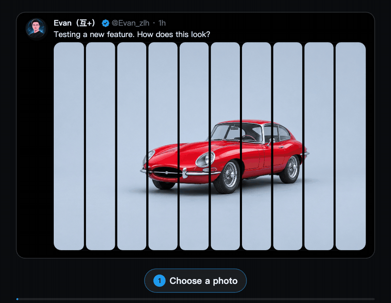

# PopoutX

**English** · [简体中文](README.zh-CN.md)

**▶ Try it now (no install): [https://lionzlh.github.io/popoutx/](https://lionzlh.github.io/popoutx/)**

PopoutX cuts a photo into up to 20 numbered images for an X (Twitter) multi-image post — and, if you want, adds a **pseudo-3D “subject breaks out of the frame” effect**. Everything runs in your browser; **your photos are never uploaded**.

**Two ways to use it**

- **Just slice** — skip the cutout. Choose how many slices (1–20) and download clean, numbered images at original resolution, perfect for a tidy multi-image post.
- **Pseudo-3D pop-out** — cut out the subject and it sits in front of the gaps between the images, as if stepping out of the picture.



## Quick start

**Just want to try it?** Open **[lionzlh.github.io/popoutx](https://lionzlh.github.io/popoutx/)** — nothing to install, and your photos stay in your browser. To run it on your own machine instead:

```bash
python3 scripts/serve.py        # then open http://127.0.0.1:47831/
```

Only Python 3 (standard library) is needed. No dependencies and no internet: the cutout model and its runtime are in the repo.

1. **Photo** — drag one in, choose a file, paste with `⌘V` / `Ctrl+V`, or click **Sample** (top right) for a guided tutorial.
2. **Cut out** *(optional — skip it if you only want to slice)* — click “Cut out subject”. Fix misses with **Erase** (remove parts wrongly included) and **Restore** (add back what was missed).
3. **Style** — pick the background (Black / White, matching how X looks for you) and the number of slices.
4. **Download** — “Download ZIP” gives one archive with numbered images inside (`01.png`, `02.png`, …); “One by one” saves each image separately. Post them to X in that order.

Shortcuts: `E` erase · `R` restore · `[` `]` brush size · hold `Space` to compare · `Esc` exit tool · `⌘S` download · `⌘Z` / `⇧⌘Z` undo / redo.

## How it works

- The photo is split evenly into N slices. A gap line counts as a cut only if it is **complete** (not erased and not hidden behind the subject). Lines hidden behind the subject join the neighbouring slices into one **main image**, where the gaps are drawn as slots with the subject in front. The other images are plain slices at original resolution.
- Cutout: U²-Net-P runs in the browser (ONNX Runtime Web, WASM) on the photo and its mirror image, then the edges are refined with a guided filter using the photo's own colours.
- Export: a store-only ZIP or one-by-one downloads. Both work in every browser and need no folder permission (Chrome refuses to let a site write into Desktop / Documents / Downloads directly, which is why there is no “save to folder” button).
- Autosave: your work is stored locally in the browser (IndexedDB); use “Resume last project” next time.
- UI languages: English / 中文 (toggle at the top right; English is the default).

> Why only Black / White: X flattens PNG transparency to a black or white background, so the gaps have to be solid colours.

## Run it online (GitHub Pages)

The app is 100% static (no backend), so it can be hosted on GitHub Pages for free:

1. Push this folder as its own repository (the repo root must contain `index.html`).
2. On GitHub: **Settings → Pages → Build and deployment → Source: “Deploy from a branch” → Branch: `main` / `/ (root)` → Save**.
3. After a minute the app is live at `https://<your-username>.github.io/<repo-name>/` (this project: https://lionzlh.github.io/popoutx/).

Everything still runs in the visitor's browser: photos are never uploaded, and `scripts/serve.py` is only needed for local use. The first cutout downloads about 15 MB (runtime + model), which the browser caches.

## Customise

- **Account shown in the preview**: edit `PROFILE` in `src/config.js` (name, handle, avatar path, verified badge) and put your avatar in `assets/`.
- **GitHub button**: set `GITHUB_URL` in `src/config.js`.
- **Sample photo**: replace `assets/sample.jpg`. Strong contrast and a simple silhouette cut out best.

## Command line

`scripts/slice.py` is a standalone, offline command-line version (`pip install numpy pillow`). It has no AI cutout — bring your own mask (white subject on black):

```bash
python3 scripts/slice.py photo.jpg -o out --images 10 --mask mask.png --theme dark
```

It merges columns by the subject's extent only; it does not include the web app's per-gap editing.

## Project layout

```
index.html            page skeleton (HTML only)
src/config.js         your settings: PROFILE (preview account), GITHUB_URL
src/i18n.js           English / 中文 strings
src/styles.css        styles
src/app.js            application logic
scripts/serve.py      local static server (listens on 127.0.0.1 only)
scripts/slice.py      command-line version (standalone, offline, bring your own mask)
models/u2netp.onnx    cutout model
vendor/ort/           ONNX Runtime Web (offline runtime)
assets/               sample photo, preview avatar
```

## Privacy

Neither the web app nor the command-line tool sends photos anywhere: cutout, rendering and export all happen on your machine, and there is no upload path in the code.

## Third-party / License

See [THIRD_PARTY_NOTICES.md](THIRD_PARTY_NOTICES.md). This project is released under the [MIT License](LICENSE).
