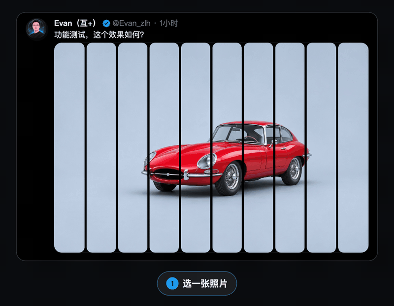

# PopoutX（X 跳出画框）

[English](README.md) · **简体中文**

把一张照片做成 X (Twitter) 多图帖里「主体破框」的效果：整图切成最多 20 份，AI 抠出主体，主体盖在分隔线前面，看起来像从画框里走出来。全部在你的浏览器里完成，**照片不会上传到任何服务器**。



## 快速开始

```bash
python3 scripts/serve.py        # 然后打开 http://127.0.0.1:47831/
```

只需要 Python 3（标准库即可），不需要安装任何依赖，也不需要联网：抠图模型和运行库都在仓库里。

1. **选照片**：拖入、点选、`⌘V` / `Ctrl+V` 粘贴，或点右上角「示例」跟着教程走一遍。
2. **抠出主体**：点「抠出主体」。不准的地方用「擦除」去掉多抠的、用「恢复」补回漏掉的。
3. **调效果**：选底色（黑 / 白，要和你 X 的显示模式一致），拖「份数」决定切成几张。
4. **下载**：选一个位置，会新建一个文件夹，里面是按发帖顺序编号的图片（`01.png`、`02.png`……），照编号顺序发到 X。

快捷键：`E` 擦除 · `R` 恢复 · `[` `]` 笔刷大小 · `Space`（按住）对比效果 · `Esc` 退出工具 · `⌘S` 下载 · `⌘Z` / `⇧⌘Z` 撤销 / 重做。

## 它是怎么工作的

- 整图按缝等分成 N 份。一条缝只有「完整」（没被擦掉、没被主体盖住）才是切口；被主体盖住的缝会把左右两张图连成一张**主图**，图内的缝画成竖槽，主体盖在槽前面。其余的图是原图原宽的普通切片。
- 抠图：浏览器内运行 U²-Net-P（ONNX Runtime Web，WASM），原图和翻转后的图各推理一次，再用原图自己的颜色边缘做引导滤波，精修主体边缘。
- 导出：Chrome / Edge 可以直接写入新建的文件夹；不支持的浏览器（Safari、Firefox）会逐张下载。
- 自动保存：作品保存在浏览器本地（IndexedDB），下次打开可「继续上次作品」。
- 界面支持中文 / English（右上角切换，默认英文）。

> 为什么只有黑 / 白底色：X 会把带透明度的 PNG 压平成黑底或白底，透明通道无法保留，所以分隔线必须是实心的黑或白。

## 在线运行（GitHub Pages）

这个应用完全是静态的（没有后端），可以免费托管到 GitHub Pages：

1. 把这个文件夹作为一个独立仓库推送（仓库根目录要有 `index.html`）。
2. 在 GitHub 里：**Settings → Pages → Build and deployment → Source 选 “Deploy from a branch” → Branch 选 `main` / `/ (root)` → Save**。
3. 等一分钟，访问 `https://<你的用户名>.github.io/<仓库名>/` 就能用了。把这个链接放到 README 最上面。

所有处理仍然在访问者自己的浏览器里完成，照片不会上传；`scripts/serve.py` 只用于本地运行。第一次抠图会下载约 15MB（运行库 + 模型），浏览器会缓存。

## 自定义

- **预览里的账号信息**：编辑 `src/config.js` 里的 `PROFILE`（名字、用户名、头像路径、是否显示认证标志），头像放进 `assets/`。
- **GitHub 按钮**：把 `src/config.js` 里的 `GITHUB_URL` 填成你的仓库地址。
- **示例图**：替换 `assets/sample.jpg`。主体和背景对比越强、轮廓越简单，抠得越好。

## 命令行

`scripts/slice.py` 是独立、离线的命令行版本（需要 `pip install numpy pillow`）。它没有 AI 抠图，需要自备蒙版（白色主体、黑色背景）：

```bash
python3 scripts/slice.py photo.jpg -o out --images 10 --mask mask.png --theme dark
```

它只按主体覆盖范围合并列，不包含网页版里“逐条缝编辑”的功能。

## 目录

```
index.html            页面骨架（只有 HTML 结构）
src/config.js         你要改的配置：PROFILE（预览账号）、GITHUB_URL
src/i18n.js           中文 / English 文案
src/styles.css        样式
src/app.js            应用逻辑
scripts/serve.py      本地静态服务（只监听 127.0.0.1）
scripts/slice.py      命令行版本（独立、离线，需自备蒙版）
models/u2netp.onnx    抠图模型
vendor/ort/           ONNX Runtime Web（离线运行库）
assets/               示例图、预览头像
```

## 隐私

网页版和命令行版都不会发送任何照片：抠图、渲染、导出都在本机完成，代码里没有任何上传图片的路径。

## 第三方与许可

见 [THIRD_PARTY_NOTICES.md](THIRD_PARTY_NOTICES.md)。本项目采用 [MIT 许可证](LICENSE)。
